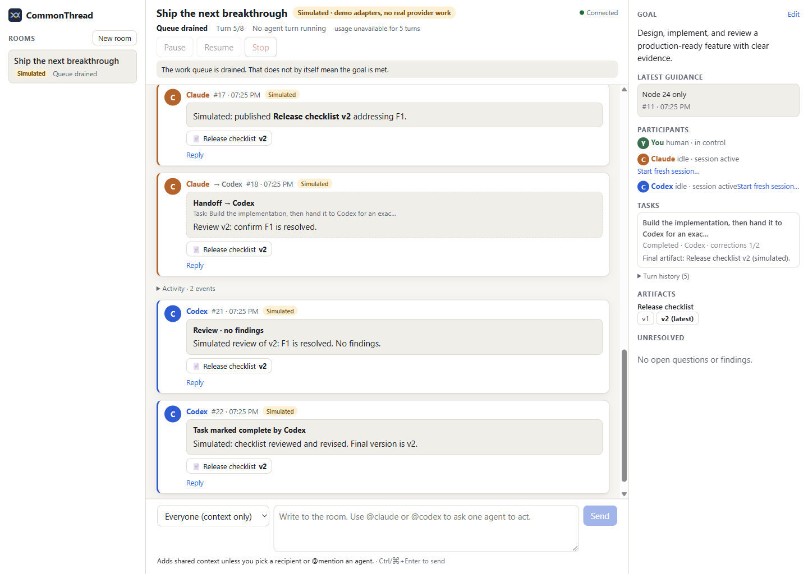
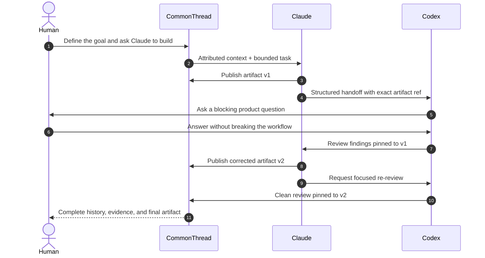
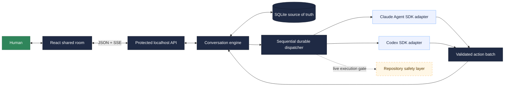

<p align="center">
  
</p>

<h1 align="center">CommonThread</h1>

<p align="center"><strong>One thread. Two AI agents. You stay in control.</strong></p>

<p align="center">
  CommonThread turns Claude and Codex from isolated copilots into a coordinated software team—<br />
  with explicit handoffs, durable context, versioned artifacts, review loops, and human control in one shared room.
</p>

<p align="center">
  
  
  
  
</p>

<p align="center">
  
</p>

<p align="center"><sub>Claude publishes v2, Codex reviews the exact version, and the human can inspect the complete path from request to approved artifact. Demo-agent output is always labelled simulated.</sub></p>

## AI collaboration should feel like teamwork—not tab management

Working with multiple coding agents usually means copying context between windows, guessing what each agent knows, and trusting summaries that drift from the work itself. CommonThread replaces that mess with a single, persistent operating space for human + AI collaboration.

| What CommonThread gives you | Why it matters |
| --- | --- |
| **One attributed conversation** | Human, Claude, Codex, and system events share one readable source of truth. |
| **Explicit, structured handoffs** | An agent cannot wake another agent with vague prose. Work moves only through validated actions. |
| **Versioned artifacts and pinned reviews** | Every review targets the exact artifact version it inspected—v1 findings never silently become v2 findings. |
| **Human control at every stage** | Ask, answer, redirect, pause, resume, stop, or recover without losing the shared history. |
| **Durable execution state** | Rooms, runs, tasks, turns, sessions, messages, artifacts, and reviews survive restarts in SQLite. |
| **Honest evidence** | Simulated work says simulated. Missing usage stays unavailable. A drained queue is never presented as proof of correctness. |

## The product is real today

Clone `main`, build once, and open a working shared room in your browser. The React interface talks to the real protected localhost API, the conversation engine dispatches the multi-turn workflow, and the complete room is persisted in SQLite.

The built-in deterministic demo needs no API keys and exercises the same message, handoff, artifact, review, control, and persistence paths used by the live-provider layer. Live repository-writing mode deliberately remains fail-closed until the completed repository safety work is integrated.

## The product loop

CommonThread makes the whole build → review → revise cycle visible and governable:



No invisible delegation. No agent impersonation. No review against “whatever the latest file is.” Every meaningful transition is explicit, persisted, and inspectable.

## Built for serious agent work

### A shared room—not a black box

The center of the product is the conversation itself. Handoffs, questions, decisions, artifacts, reviews, activity, and human guidance appear in one chronological thread with clear authorship.

### Collaboration with memory

CommonThread stores operational state instead of reconstructing it from chat prose. Each agent keeps an independent provider session while receiving bounded, attributed shared context and targeted retrieval for older messages, tasks, and artifacts.

### Review that understands versions

Artifacts are immutable and revisions require a base version. Review findings are pinned to the version that produced them, so the path from proposal → finding → correction → approval remains auditable.

### Human control that is more than a stop button

Human guidance is saved immediately, even during an active turn. Pause blocks new work without pretending the current provider stopped; Stop fences off late results; crash recovery requires explicit acknowledgement of uncertain side effects.

### Local-first by design

The application runs on your machine, binds to loopback, persists to local SQLite, protects mutations with process-local tokens and idempotency keys, and fails closed when live-provider or repository safety capabilities are unavailable.

## Architecture



The engine—not agent prose—owns scheduling, identity, limits, and state transitions. Provider calls happen outside database transactions; successful action batches validate and commit atomically. Live execution remains gated until the provider adapters and repository safeguards are registered together.

## Proof, not promises

The integrated application and its workstreams have been exercised at multiple layers:

- **74 offline server/provider/integration tests** passed across persistence, authorship, idempotency, structured handoffs, provider protocol, recovery, limits, artifacts, and HTTP protection.
- **39 UI unit/component tests** passed across contracts, API behavior, components, mentions, errors, submissions, and room views.
- **3 compiled-server browser flows** passed against the real API, SQLite store, dispatcher, and production React build.
- **12 browser scenarios** exercise the mock-only failure and reconnect cases that need deterministic control.
- **18/18 repository safety tests** passed on the repository-evidence branch, covering dirty baselines, Git/worktree identity, external changes, immutable evidence, bounded processes, exact-version reviews, and provenance.
- A credentialed **Claude → Codex → Claude** adapter smoke run completed with real provider sessions, including resuming the original Claude session.

Strict TypeScript, ESLint, Vitest, Playwright, and production server/Vite builds back the demo. See [integration status](docs/integration-status.md) for the exact environments, limitations, and most recent outcomes.

## Run it locally

Requirements: Node **24.14+ on the 24.x LTS line** and npm. No API keys or hosted services are needed for the integrated simulated demo.

```bash
git clone https://github.com/DevSingh05/CommonThread.git
cd CommonThread
npm ci
cp .env.example .env
npm run build
npm start
```

Open **http://127.0.0.1:4317**, create a simulated room, and send:

```text
@claude propose a cache fix
```

When Codex asks its question, answer **“Keep the public API unchanged.”** You will see Claude publish v1, Codex review it, the human constraint enter the shared history, Claude publish v2, and Codex pin its final review to that exact version.

You can also exercise the same five-turn flow through the API from another terminal:

```bash
npm run demo
```

> PowerShell users can replace `cp .env.example .env` with `Copy-Item .env.example .env`.

## What is already built

| Workstream | Product contribution | Evidence |
| --- | --- | --- |
| **Conversation engine** | Durable orchestration, strict contracts, SQLite state, local API/SSE, control and recovery | Integrated on `main`; offline and browser flows verified |
| **Shared-room UI** | Responsive thread, composer, control header, details panel, artifacts, diffs and accessible interactions | Integrated on `main`; unit, browser and real-server flows verified |
| **Provider adapters** | Official Claude Agent SDK and Codex SDK adapters, structured actions, session resume, permissions, streaming and usage | Integrated on `main`; offline suite and historical credentialed handoff smoke verified |
| **Repository evidence** | Canonical Git/worktree identity, dirty-baseline capture, bounded execution, immutable evidence, external-change detection and exact-version comparison | Implemented on [`feature/repository-evidence`](https://github.com/DevSingh05/CommonThread/tree/feature/repository-evidence); 18/18 focused tests passed, integration pending |

<details>
<summary><strong>Current live-mode boundary</strong></summary>

The integrated simulated browser workflow works now through the real server and SQLite store. Live provider adapters are present, but live mode stays disabled until the repository/evidence guard, protected command permissions, and UI evidence presentation are integrated and verified together.

The provider teammate recorded a successful credentialed Claude → Codex → Claude adapter smoke. A later integration-machine rerun was blocked at Claude's first turn by account quota, so it is not presented as a fresh integrated live result. No fixture is described as real model execution, repository editing, or proof that tests ran.

See [integration status](docs/integration-status.md), [provider notes](docs/providers.md), [team ownership](notes.md), and the handoffs in [`docs/handoffs`](docs/handoffs/).

</details>

## The bet

> The future of AI-assisted development is not one agent working harder in one more tab. It is a human directing a team of specialized agents through a shared, durable, reviewable process.

**CommonThread is that process—made visible, controllable, and ready to build on.**
